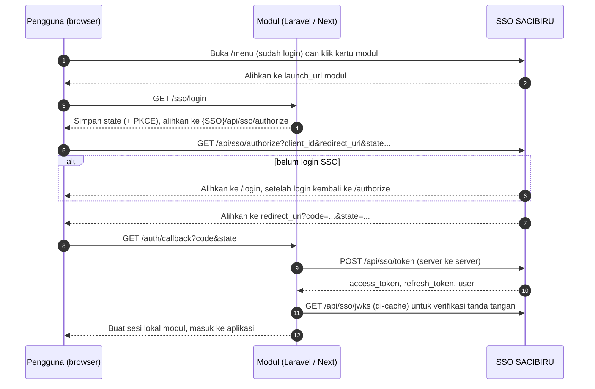

# SACIBIRU SSO — Dokumentasi Integrasi

SACIBIRU bertindak sebagai **identity provider**: pengguna login sekali di SSO, lalu membuka modul
(Laravel, Next.js, dan lainnya) dari **Menu Utama**. Modul tidak pernah melihat password. Modul
hanya menerima **kode sekali pakai**, menukarnya dengan **access token (JWT RS256)** lewat
komunikasi server ke server, lalu membuat sesinya sendiri.

Alurnya mengikuti OAuth 2.0 *Authorization Code* (dengan PKCE opsional). Library OAuth/OIDC
standar di PHP maupun JavaScript bisa dipakai, atau cukup `fetch`/HTTP client biasa seperti contoh di bawah.

- [1. Alur login](#1-alur-login)
- [2. Menyiapkan modul](#2-menyiapkan-modul)
- [3. Referensi endpoint](#3-referensi-endpoint)
- [4. Access token](#4-access-token)
- [5. Kode galat](#5-kode-galat)
- [6. Contoh integrasi Laravel](#6-contoh-integrasi-laravel)
- [7. Contoh integrasi Next.js](#7-contoh-integrasi-nextjs)
- [8. Sesi, refresh, dan logout](#8-sesi-refresh-dan-logout)
- [9. Daftar periksa keamanan](#9-daftar-periksa-keamanan)
- [10. Batasan saat ini](#10-batasan-saat-ini)

Pada dokumen ini `{SSO}` adalah alamat publik SSO (mis. `https://sso.kampus.ac.id`).

## 1. Alur login



Ringkasnya:

1. Modul yang memulai login (`launch_url` kartu menunjuk ke rute modul, bukan langsung ke SSO).
   Dengan begitu `state` dibuat dan diikat ke browser oleh modul itu sendiri.
2. SSO memeriksa sesinya. Pengguna yang sudah login langsung diteruskan tanpa mengetik ulang password.
3. Modul menukar `code` di sisi server, memverifikasi JWT, lalu membuat sesi lokal.

Umur token: kode 60 detik (sekali pakai), access token 15 menit, refresh token 30 hari (dirotasi).

## 2. Menyiapkan modul

### 2.1 Daftarkan modul sebagai klien

Dijalankan oleh pengelola SSO di repo SSO (memakai `DATABASE_URL` pada `.env`, jadi pastikan
database yang dituju benar):

```bash
npm run sso:client -- create \
  --client-id modul-laravel \
  --name "Modul Laravel" \
  --description "Deskripsi singkat di kartu menu" \
  --launch-url https://laravel.kampus.ac.id/sso/login \
  --redirect-uri https://laravel.kampus.ac.id/auth/callback \
  --logout-uri https://laravel.kampus.ac.id/ \
  --roles Dosen,Kaprodi
```

Hasilnya mencetak `client_secret` **satu kali**. Berikan ke tim modul lewat jalur aman; di SSO hanya hash-nya yang disimpan.

| Opsi | Arti |
|---|---|
| `--client-id` | Pengenal publik modul (huruf kecil, angka, `.`, `_`, `-`). |
| `--launch-url` | Tujuan kartu di Menu Utama. Harus rute modul yang memulai login. |
| `--redirect-uri` | Satu atau lebih (pisah koma). Dicocokkan **persis**, tanpa wildcard. |
| `--logout-uri` | Tujuan setelah logout (opsional). |
| `--roles` | Role yang boleh membuka modul: `Kaprodi`, `Dosen`, `Admin`. Role lain mendapat `access_denied`. |
| `--public` | Klien publik tanpa `client_secret` (mis. SPA). Wajib memakai PKCE. |

Aturan URL: `https` wajib (kecuali `http://localhost` / `127.0.0.1` untuk pengembangan), tanpa fragmen `#`.

Perintah lain:

```bash
npm run sso:client -- list
npm run sso:client -- rotate-secret --client-id modul-laravel
npm run sso:client -- disable --client-id modul-laravel
```

`disable` menonaktifkan klien dan mencabut seluruh refresh token-nya.

### 2.2 Konfigurasi SSO (pengelola)

| Variabel | Keterangan |
|---|---|
| `SSO_PRIVATE_KEY` | Kunci privat RS256 (PEM PKCS8), **wajib di production**. Buat dengan `npm run sso:keys`. Di Vercel isi satu baris dengan `\n` sebagai pemisah baris. |
| `SSO_KEY_ID` | Opsional, `kid` kunci. Bawaan: thumbprint kunci publik. |
| `SSO_ISSUER` | Opsional, alamat publik SSO tanpa `/` akhir. Isi bila SSO di belakang proxy yang mengubah host. Nilainya menjadi klaim `iss`. |

Migrasi database: terapkan `prisma migrate deploy` agar tabel `sso_clients`, `sso_auth_codes`, dan `sso_refresh_tokens` terbentuk.

### 2.3 Konfigurasi modul

Yang perlu dimiliki tim modul: `SSO_URL`, `SSO_CLIENT_ID`, `SSO_CLIENT_SECRET`, dan `SSO_REDIRECT_URI`
(harus sama persis dengan yang didaftarkan).

## 3. Referensi endpoint

Semua endpoint ada di bawah `{SSO}/api/sso`. Respons token dan galat memakai `Cache-Control: no-store`.

### 3.1 `GET /authorize`: mulai login (lewat browser)

Dipanggil dengan **mengalihkan browser pengguna**, bukan lewat `fetch`.

| Parameter | Wajib | Keterangan |
|---|---|---|
| `client_id` | ya | `client_id` modul. |
| `redirect_uri` | ya | Harus sama persis dengan salah satu yang terdaftar. |
| `response_type` | ya | Harus `code`. |
| `state` | disarankan | Nilai acak yang dibuat modul, dikembalikan apa adanya. **Wajib diverifikasi modul** untuk mencegah CSRF. |
| `code_challenge` | wajib untuk klien publik | `base64url(sha256(code_verifier))`, 43 karakter. |
| `code_challenge_method` | bila ada `code_challenge` | Harus `S256`. |

Perilaku:

| Kondisi | Hasil |
|---|---|
| `client_id` atau `redirect_uri` tidak sah | **400 JSON** `invalid_request`. Tidak pernah dialihkan ke alamat tak tepercaya. |
| `response_type`/PKCE salah | Dialihkan ke `redirect_uri?error=...&error_description=...&state=...`. |
| Belum login SSO | Dialihkan ke `/login`, setelah login kembali otomatis ke permintaan ini. |
| Role tidak diizinkan | Dialihkan ke `redirect_uri?error=access_denied&state=...`. |
| Berhasil | Dialihkan ke `redirect_uri?code=...&state=...`. |

Contoh:

```
GET https://sso.kampus.ac.id/api/sso/authorize
  ?client_id=modul-laravel
  &redirect_uri=https%3A%2F%2Flaravel.kampus.ac.id%2Fauth%2Fcallback
  &response_type=code
  &state=Zk3x...
  &code_challenge=E9Melhoa2OwvFrEMTJguCHaoeK1t8URWbuGJSstw-cM
  &code_challenge_method=S256
```

### 3.2 `POST /token`: tukar kode atau perbarui token (server ke server)

Body boleh `application/x-www-form-urlencoded` (standar OAuth) atau `application/json`.

**Autentikasi klien:** kirim `client_id` dan `client_secret` di body, **atau** lewat header
`Authorization: Basic base64(urlencode(client_id):urlencode(client_secret))`. Klien publik hanya
mengirim `client_id` (tanpa secret) dan memakai PKCE.

#### a) `grant_type=authorization_code`

| Parameter | Wajib | Keterangan |
|---|---|---|
| `grant_type` | ya | `authorization_code` |
| `code` | ya | Kode dari callback. Sekali pakai, berlaku 60 detik. |
| `redirect_uri` | ya | Harus sama persis dengan yang dikirim ke `/authorize`. |
| `code_verifier` | bila memakai PKCE | Nilai asli sebelum di-hash (43–128 karakter `A-Za-z0-9-._~`). |

```bash
curl -X POST https://sso.kampus.ac.id/api/sso/token \
  -d grant_type=authorization_code \
  -d client_id=modul-laravel \
  -d client_secret=RAHASIA_KLIEN \
  -d code=KODE_DARI_CALLBACK \
  -d redirect_uri=https://laravel.kampus.ac.id/auth/callback \
  -d code_verifier=VERIFIER_PKCE
```

#### b) `grant_type=refresh_token`

| Parameter | Wajib | Keterangan |
|---|---|---|
| `grant_type` | ya | `refresh_token` |
| `refresh_token` | ya | Refresh token terakhir yang diterima. |

```bash
curl -X POST https://sso.kampus.ac.id/api/sso/token \
  -d grant_type=refresh_token \
  -d client_id=modul-laravel \
  -d client_secret=RAHASIA_KLIEN \
  -d refresh_token=REFRESH_TERAKHIR
```

#### Respons sukses `200`

```json
{
  "access_token": "eyJhbGciOiJSUzI1NiIsImtpZCI6Ii4uLiJ9...",
  "token_type": "Bearer",
  "expires_in": 900,
  "refresh_token": "u7Qf...",
  "user": {
    "sub": "6b1f0c52-...",
    "name": "Indira Nareswari Syawanodya, M.T.",
    "email": "indira@upi.edu",
    "nip": "199008212018032001",
    "role": "Dosen"
  }
}
```

**Refresh token dirotasi:** setiap pembaruan menghasilkan refresh token baru dan mencabut yang lama.
Simpan yang terbaru. Memakai token yang sudah dicabut dianggap pencurian dan **membatalkan seluruh
rantai token** untuk pengguna dan modul itu, sehingga pengguna harus login ulang.

### 3.3 `GET /userinfo`: cek sesi

Mengembalikan data pengguna **terbaru dari database** untuk access token yang sah. Berguna bila
modul ingin memastikan akun masih ada atau role belum berubah, tanpa menunggu token habis.

```bash
curl https://sso.kampus.ac.id/api/sso/userinfo \
  -H "Authorization: Bearer ACCESS_TOKEN"
```

```json
{
  "sub": "6b1f0c52-...",
  "name": "Indira Nareswari Syawanodya, M.T.",
  "email": "indira@upi.edu",
  "nip": "199008212018032001",
  "role": "Dosen"
}
```

Gagal: `401` dengan header `WWW-Authenticate: Bearer error="invalid_token"`. Token kedaluwarsa, rusak,
diterbitkan penerbit lain, atau pengguna sudah dihapus.

Jangan memanggil endpoint ini di setiap request. Verifikasi JWT secara lokal (bagian 4) dan
panggil `userinfo` hanya pada aksi penting atau saat memperbarui sesi.

### 3.4 `GET /jwks`: kunci publik

```bash
curl https://sso.kampus.ac.id/api/sso/jwks
```

```json
{
  "keys": [
    { "kty": "RSA", "n": "...", "e": "AQAB", "kid": "0Zs...", "alg": "RS256", "use": "sig" }
  ]
}
```

Respons memuat `Cache-Control: public, max-age=300`. Cache di sisi modul (5 menit sudah cukup) dan
ambil ulang bila menemukan `kid` yang belum dikenal (kunci diganti).

### 3.5 `GET /logout`: keluar dari SSO (lewat browser)

| Parameter | Wajib | Keterangan |
|---|---|---|
| `client_id` | tidak | Dipakai untuk memeriksa `post_logout_redirect_uri`. |
| `post_logout_redirect_uri` | tidak | Harus salah satu `--logout-uri` yang terdaftar untuk klien itu. |
| `state` | tidak | Ditambahkan ke URL tujuan. |

Efeknya: **semua refresh token pengguna dicabut** (di semua modul), cookie sesi SSO dihapus, lalu browser
dialihkan ke `post_logout_redirect_uri` (jika sah) atau ke halaman login SSO. URI yang tidak terdaftar
diabaikan, bukan menjadi galat. Lihat bagian 8 untuk menghubungkannya dengan sesi lokal modul.

```
GET https://sso.kampus.ac.id/api/sso/logout
  ?client_id=modul-laravel
  &post_logout_redirect_uri=https%3A%2F%2Flaravel.kampus.ac.id%2F
```

## 4. Access token

JWT bertanda tangan **RS256**. Modul memverifikasi sendiri dengan kunci publik dari `/jwks`;
tidak ada rahasia bersama dan SSO tidak dipanggil di setiap request.

Header: `{"alg":"RS256","typ":"JWT","kid":"..."}`

| Klaim | Arti |
|---|---|
| `iss` | Penerbit: alamat SSO (`SSO_ISSUER`). **Wajib dicocokkan.** |
| `aud` | `client_id` modul tujuan. **Wajib dicocokkan** agar token modul lain tidak diterima. |
| `sub` | ID pengguna (stabil, pakai sebagai kunci akun di modul). |
| `exp`, `iat` | Kedaluwarsa dan waktu terbit (15 menit). |
| `name`, `email`, `nip` | Profil pengguna. |
| `role` | `Kaprodi`, `Dosen`, atau `Admin`. |

Yang harus dipastikan modul saat verifikasi: algoritma hanya `RS256` (tolak `none`/`HS256`),
tanda tangan sah menurut kunci dengan `kid` tersebut, `iss` sama dengan alamat SSO, `aud` sama
dengan `client_id` sendiri, dan `exp` belum lewat.

## 5. Kode galat

Galat dari `/token`, `/userinfo`, dan `/authorize` (kasus 400) memakai format OAuth:

```json
{ "error": "invalid_grant", "error_description": "Kode sudah dipakai." }
```

| Kode | HTTP | Penyebab umum |
|---|---|---|
| `invalid_request` | 400 | Parameter wajib hilang atau `client_id`/`redirect_uri` tidak sah. |
| `invalid_client` | 401 | `client_id` tidak dikenal/nonaktif, `client_secret` salah, atau klien publik mengirim secret. |
| `invalid_grant` | 400 | Kode/refresh token salah, kedaluwarsa, sudah dipakai, `redirect_uri` berbeda, `code_verifier` salah, atau role pengguna tidak lagi diizinkan. |
| `unsupported_grant_type` | 400 | `grant_type` bukan `authorization_code`/`refresh_token`. |
| `unsupported_response_type` | redirect | `response_type` bukan `code`. |
| `access_denied` | redirect | Role pengguna tidak diizinkan di modul ini. |
| `invalid_token` | 401 | Access token tidak valid, kedaluwarsa, atau pengguna sudah dihapus. |
| `server_error` | 500 | Kesalahan di server SSO (detail tidak dibocorkan). |

## 6. Contoh integrasi Laravel

Cuplikan memakai HTTP client bawaan Laravel dan `firebase/php-jwt` (`composer require firebase/php-jwt`).
Ini contoh minimal; sesuaikan dengan struktur proyek.

`config/sso.php`:

```php
return [
    'url'           => env('SSO_URL'),                       // https://sso.kampus.ac.id
    'client_id'     => env('SSO_CLIENT_ID'),
    'client_secret' => env('SSO_CLIENT_SECRET'),
    'redirect_uri'  => env('SSO_REDIRECT_URI'),              // sama persis dengan yang terdaftar
];
```

`routes/web.php`:

```php
Route::get('/sso/login', [SsoController::class, 'login']);
Route::get('/auth/callback', [SsoController::class, 'callback']);
Route::post('/logout', [SsoController::class, 'logout'])->middleware('auth');
```

`app/Http/Controllers/SsoController.php`:

```php
use Firebase\JWT\JWK;
use Firebase\JWT\JWT;
use Illuminate\Support\Facades\Cache;
use Illuminate\Support\Facades\Http;
use Illuminate\Support\Str;

class SsoController extends Controller
{
    public function login(Request $request)
    {
        $state    = Str::random(40);
        $verifier = Str::random(64);
        $request->session()->put(['sso_state' => $state, 'sso_verifier' => $verifier]);

        $challenge = rtrim(strtr(base64_encode(hash('sha256', $verifier, true)), '+/', '-_'), '=');

        return redirect(config('sso.url') . '/api/sso/authorize?' . http_build_query([
            'client_id'             => config('sso.client_id'),
            'redirect_uri'          => config('sso.redirect_uri'),
            'response_type'         => 'code',
            'state'                 => $state,
            'code_challenge'        => $challenge,
            'code_challenge_method' => 'S256',
        ]));
    }

    public function callback(Request $request)
    {
        $expected = (string) $request->session()->pull('sso_state', '');
        abort_unless($expected !== '' && hash_equals($expected, (string) $request->query('state')), 400, 'State tidak cocok.');

        if ($request->query('error')) {
            abort(403, (string) $request->query('error_description', 'Akses ditolak.'));
        }

        $response = Http::asForm()->post(config('sso.url') . '/api/sso/token', [
            'grant_type'    => 'authorization_code',
            'client_id'     => config('sso.client_id'),
            'client_secret' => config('sso.client_secret'),
            'code'          => $request->query('code'),
            'redirect_uri'  => config('sso.redirect_uri'),
            'code_verifier' => $request->session()->pull('sso_verifier'),
        ]);
        abort_unless($response->ok(), 401, 'Login SSO gagal.');
        $tokens = $response->json();

        // Verifikasi lokal dengan kunci publik (jwks di-cache 5 menit).
        $jwks    = Cache::remember('sso_jwks', 300, fn () => Http::get(config('sso.url') . '/api/sso/jwks')->json());
        $claims  = JWT::decode($tokens['access_token'], JWK::parseKeySet($jwks));
        abort_unless(
            $claims->iss === config('sso.url') && $claims->aud === config('sso.client_id'),
            401, 'Token tidak sah.'
        );

        // Cocokkan akun lokal dengan sub (atau email), lalu buat sesi Laravel.
        $user = User::updateOrCreate(
            ['sso_sub' => $claims->sub],
            ['name' => $claims->name, 'email' => $claims->email, 'role' => $claims->role],
        );
        Auth::login($user);
        $request->session()->regenerate();
        $request->session()->put('sso_refresh_token', encrypt($tokens['refresh_token']));
        $request->session()->put('sso_expires_at', $claims->exp);

        return redirect('/');
    }

    public function logout(Request $request)
    {
        Auth::logout();
        $request->session()->invalidate();

        return redirect(config('sso.url') . '/api/sso/logout?' . http_build_query([
            'client_id'                => config('sso.client_id'),
            'post_logout_redirect_uri' => url('/'),
        ]));
    }
}
```

Catatan: `JWT::decode` pada `firebase/php-jwt` v6 memakai `alg` dari JWK (`RS256`), sehingga
algoritma tidak bisa dipaksa turun. Pastikan `config('sso.url')` sama dengan `iss` (tanpa `/` akhir).

## 7. Contoh integrasi Next.js

Memakai `jose` (`npm i jose`) dan Route Handler. Contoh ini membuat cookie sesi sendiri; bila memakai
Auth.js, daftarkan SSO sebagai provider OIDC/OAuth kustom dengan endpoint yang sama.

`app/sso/login/route.ts`:

```ts
import { createHash, randomBytes } from "node:crypto";
import { NextResponse } from "next/server";

export async function GET() {
  const state = randomBytes(24).toString("base64url");
  const verifier = randomBytes(48).toString("base64url");
  const challenge = createHash("sha256").update(verifier).digest("base64url");

  const url = new URL("/api/sso/authorize", process.env.SSO_URL);
  url.search = new URLSearchParams({
    client_id: process.env.SSO_CLIENT_ID!,
    redirect_uri: process.env.SSO_REDIRECT_URI!,
    response_type: "code",
    state,
    code_challenge: challenge,
    code_challenge_method: "S256",
  }).toString();

  const response = NextResponse.redirect(url);
  response.cookies.set("sso_tx", JSON.stringify({ state, verifier }), {
    httpOnly: true, secure: true, sameSite: "lax", path: "/", maxAge: 600,
  });
  return response;
}
```

`app/auth/callback/route.ts`:

```ts
import { createRemoteJWKSet, jwtVerify, SignJWT } from "jose";
import { NextResponse, type NextRequest } from "next/server";

const jwks = createRemoteJWKSet(new URL("/api/sso/jwks", process.env.SSO_URL)); // di-cache otomatis

export async function GET(request: NextRequest) {
  const params = request.nextUrl.searchParams;
  const tx = JSON.parse(request.cookies.get("sso_tx")?.value ?? "{}");

  if (!tx.state || tx.state !== params.get("state")) {
    return NextResponse.json({ error: "State tidak cocok." }, { status: 400 });
  }
  if (params.get("error")) {
    return NextResponse.json({ error: params.get("error_description") }, { status: 403 });
  }

  const res = await fetch(new URL("/api/sso/token", process.env.SSO_URL), {
    method: "POST",
    headers: { "content-type": "application/x-www-form-urlencoded" },
    body: new URLSearchParams({
      grant_type: "authorization_code",
      client_id: process.env.SSO_CLIENT_ID!,
      client_secret: process.env.SSO_CLIENT_SECRET!,
      code: params.get("code") ?? "",
      redirect_uri: process.env.SSO_REDIRECT_URI!,
      code_verifier: tx.verifier,
    }),
  });
  if (!res.ok) return NextResponse.json({ error: "Login SSO gagal." }, { status: 401 });
  const tokens = await res.json();

  // Verifikasi lokal: tanda tangan, iss, aud, exp.
  const { payload } = await jwtVerify(tokens.access_token, jwks, {
    issuer: process.env.SSO_URL!, // tanpa "/" akhir
    audience: process.env.SSO_CLIENT_ID!,
    algorithms: ["RS256"],
  });

  // Sesi lokal berumur sama dengan access token; diperbarui dengan refresh token.
  const session = await new SignJWT({ sub: payload.sub, name: payload.name, role: payload.role })
    .setProtectedHeader({ alg: "HS256" })
    .setExpirationTime(payload.exp!)
    .sign(new TextEncoder().encode(process.env.SESSION_SECRET!));

  const response = NextResponse.redirect(new URL("/", request.url));
  response.cookies.set("app_session", session, { httpOnly: true, secure: true, sameSite: "lax", path: "/" });
  response.cookies.set("sso_refresh", tokens.refresh_token, { httpOnly: true, secure: true, sameSite: "lax", path: "/" });
  response.cookies.delete("sso_tx");
  return response;
}
```

## 8. Sesi, refresh, dan logout

**Dua lapis sesi.** SSO punya sesi sendiri (cookie di domain SSO), dan tiap modul punya sesi lokal.
Keluar dari SSO tidak otomatis menghapus sesi lokal modul, sehingga modul perlu mengikatnya ke token.

Pola yang disarankan:

1. Umur sesi lokal modul = umur access token (15 menit).
2. Saat sesi lokal habis dan pengguna masih aktif, modul memanggil `POST /token` dengan
   `grant_type=refresh_token`. Bila berhasil, perbarui sesi dan **simpan refresh token baru**.
3. Bila `/token` menjawab `invalid_grant`, anggap pengguna sudah logout atau akunnya dicabut:
   hapus sesi lokal dan arahkan ke `/sso/login`.

Dengan pola ini, logout di SSO (atau dari modul mana pun) mencabut semua refresh token, sehingga
modul lain ikut keluar paling lambat 15 menit kemudian.

**Logout dari modul:** hapus sesi lokal, lalu alihkan browser ke `GET /api/sso/logout` dengan
`client_id` dan `post_logout_redirect_uri` (bagian 3.5). **Logout dari Menu Utama SSO** (`/logout`)
juga mencabut semua refresh token.

**Akun dinonaktifkan atau role berubah:** `userinfo` dan `refresh_token` selalu memeriksa data
terbaru di database, jadi perubahan itu berlaku paling lambat saat access token berikutnya diperbarui.

## 9. Daftar periksa keamanan

Untuk tim modul:

- [ ] `client_secret` hanya di server (env), tidak pernah di frontend atau repo.
- [ ] Buat `state` acak per percobaan login, simpan terikat ke browser, dan **tolak callback bila tidak cocok**.
- [ ] Pakai PKCE (`S256`) walau klien rahasia. Wajib untuk klien publik.
- [ ] Tukar `code` hanya dari backend. Jangan pernah menaruh access token di URL atau `localStorage`.
- [ ] Verifikasi JWT: hanya `RS256`, `iss`, `aud` = `client_id` sendiri, `exp`, dan `kid` dari JWKS.
- [ ] Cookie sesi modul: `HttpOnly`, `Secure`, `SameSite=Lax`.
- [ ] Simpan refresh token terenkripsi/server-side, dan selalu ganti dengan yang terbaru setelah refresh.
- [ ] Jangan menerima token yang `aud`-nya modul lain.
- [ ] Cache JWKS maksimal beberapa menit dan ambil ulang bila ada `kid` baru.

Untuk pengelola SSO:

- [ ] `SSO_PRIVATE_KEY` hanya di environment, tidak di repo. Ganti kunci bila diduga bocor
      (semua access token langsung tidak berlaku; refresh token tetap berlaku).
- [ ] `redirect_uri` didaftarkan lengkap dan `https`. Jangan daftarkan alamat yang tidak dikuasai.
- [ ] `rotate-secret` bila `client_secret` diduga bocor; `disable` bila modul dihentikan.
- [ ] Batasi `--roles` seperlunya: role yang tidak terdaftar tidak bisa membuka modul.

## 10. Batasan saat ini

Hal berikut belum dibuat dan perlu dipertimbangkan sesuai kebutuhan:

- **Back-channel logout**: SSO tidak memanggil modul saat logout. Modul keluar saat refresh gagal
  (lihat bagian 8), bukan seketika.
- **Pembatasan percobaan (rate limiting)** pada `/token` dan login belum ada.
- **Tanpa scope**: klaim yang dikembalikan tetap (`sub`, `name`, `email`, `nip`, `role`).
- **Tanpa halaman persetujuan (consent)**: modul terdaftar dianggap tepercaya.
- **Tanpa discovery** (`/.well-known/openid-configuration`): konfigurasikan endpoint secara manual
  seperti pada dokumen ini. Library OIDC yang mewajibkan discovery perlu diatur manual.
- **Satu kunci aktif** pada JWKS: mengganti kunci memutus semua access token yang beredar sekaligus.
- **Logout lewat `GET`** (mengikuti pola end-session OIDC) sehingga tautan pihak ketiga bisa
  memicu logout pengguna; dampaknya hanya mengeluarkan pengguna.
- Belum ada halaman untuk mengelola klien; gunakan `npm run sso:client`.
